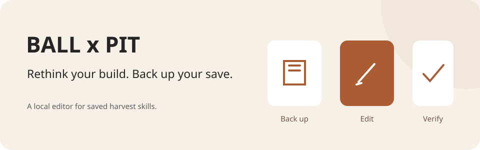

# BALL x PIT Save Editor

**Rethink your build. Back up your save.**



An unofficial editor for saved harvest skills. Use the browser editor for local file processing,
or the Python CLI for a workflow with persistent backup folders.

[**Open the editor →**](https://nickdrezza.github.io/ballxpit-save-editor/)
· [CLI](#command-line)
· [Known issues](docs/known-issues.md)

> [!WARNING]
> This is an unofficial, open-source save editor for **BALL x PIT**.
> It is unstable, incomplete, and may break after game updates.
> It may corrupt saves, conflict with Steam Cloud, or leave your progress in an unexpected state.
> **Use it entirely at your own risk.**

> [!IMPORTANT]
> Before replacing live save files:
> 1. Disable **Steam Cloud** for BALL x PIT.
> 2. Keep untouched backups of your original files.
> 3. Test small edits first.
> 4. Verify the result in-game before making more changes.

## What you can change

This editor focuses on saved harvest choices:

- inspect your roster
- reshuffle saved harvest skills without changing the save structure
- keep the workflow understandable
- avoid server-side save handling
- document the parts of the game's upgrade logic we still have not decoded

It stays conservative by default, with an optional Unlocked mode for users who knowingly want to bypass level checks.

## Quick Start

### Website

1. Open the hosted site or serve this repository as static files.
2. Upload your save bundle, ideally including `meta1.yankai` and `meta1_backup.yankai`.
3. Click **Download backup package** and keep the downloaded `backupMMDDYYYYHHMM.zip` file somewhere safe.
4. Reshuffle harvest skills for editable characters.
5. Click **Download edited bundle**.
6. Manually replace your local BALL x PIT save files with the edited downloads.

### CLI

```bash
git clone https://github.com/nickdrezza/ballxpit-save-editor.git
cd ballxpit-save-editor
python3 -m venv .venv
. .venv/bin/activate
python3 -m pip install --upgrade pip setuptools
python3 -m pip install -e .
ballxpit-save-editor list-chars
```

## Browser Editor

The browser editor is the main surface of this project.

What it does:

- runs entirely client-side
- roundtrip-checks the uploaded primary save before allowing edits
- dims out 0 XP and unused character slots
- lets editable characters choose any supported harvest skill for each existing saved skill slot
- keeps normal edits inside the character's level-unlocked slot count
- includes Unlocked mode for bypassing the level check without adding save slots
- downloads rewritten files back to you instead of touching your save folder directly
- exports zipped backup packages and keeps a selectable local restore list in browser storage

What it does **not** do:

- it does not upload your save to a server
- it does not write directly into the Steam save directory
- it does not claim to fully emulate the game's real offer-generation logic yet

<details>
<summary>Host it yourself</summary>

## Host It Yourself

This repo is intentionally easy to self-host because the website is just static files.

### Vercel

1. Push this repo to GitHub, or upload the project folder directly.
2. Create a new Vercel project.
3. Use the repository root as the project root.
4. Framework preset: `Other`.
5. Build command: leave empty.
6. Output directory: leave empty.
7. Deploy.

The repository includes [`vercel.json`](./vercel.json) so the root site can be served as a simple static deployment.

### Any Static Host

You only need these files at minimum:

- `index.html`
- `styles.css`
- `app.js`

That means the project can be hosted on:

- Vercel
- Netlify
- GitHub Pages
- Cloudflare Pages
- an S3-style static bucket
- any plain web server

### Local Static Serving

```bash
cd ballxpit-save-editor
python3 -m http.server 4173
```

Then open `http://localhost:4173`.

</details>

## Command Line

The CLI stays useful when you want a local, file-system-aware workflow with persistent backup folders.

### Install

```bash
python3 -m venv .venv
. .venv/bin/activate
python3 -m pip install --upgrade pip setuptools
python3 -m pip install -e .
```

### Common Commands

```bash
ballxpit-save-editor list-chars
ballxpit-save-editor list-upgrades
ballxpit-save-editor verify-roundtrip
ballxpit-save-editor replace-upgrade --char-type Warrior --from Stonepiercer --to Woodpecker
ballxpit-save-editor list-backups
ballxpit-save-editor delete-backups --keep 5
```

### CLI Safety Model

The CLI is more automated than the website:

- it creates persistent backups in `./backups`
- it verifies serialized output before writing
- it writes to the live save files only after verification
- it re-reads the written files and verifies the expected upgrade state again
- it restores the fresh backup if final verification fails

## Current Guardrail

The browser editor follows these rules:

- any editable character can pick any supported harvest skill
- normal mode respects level unlock counts at levels `3`, `6`, and `10`
- the editor never creates additional harvest skill nodes; it only rewrites existing saved slots
- Unlocked mode bypasses the level unlock check for users who knowingly want an impossible or cheat-style build
- unused, locked, 0 XP, and special no-harvest character slots remain read-only

The CLI is still the lower-level tool in the repo and does not yet mirror every browser-side convenience.

## Known Issues

The biggest unresolved area is the real in-game harvest-offer system.

We have evidence that:

- the game computes a legal pool dynamically
- visible choices may be sampled from that pool
- hidden per-upgrade tier values exist in the save

We do **not** yet have a complete, confirmed model for:

- exact offer pools per character
- exact upgrade checkpoints in all cases
- how all hidden tier values should be interpreted

Tracking file:

- [Harvest Upgrade Pair Research](./docs/harvest-upgrade-pair-research.md)
- [Known Issues](./docs/known-issues.md)

<details>
<summary>Project layout and development</summary>

## Project Layout

```text
ballxpit-save-editor/
├─ LICENSE
├─ README.md
├─ app.js
├─ index.html
├─ styles.css
├─ vercel.json
├─ backups/
├─ docs/
│  ├─ harvest-upgrade-pair-research.md
│  └─ known-issues.md
├─ runtime/
├─ pyproject.toml
└─ src/
   └─ ballxpit_save_editor/
      ├─ __init__.py
      ├─ __main__.py
      └─ editor.py
```

## Development

### Smoke Checks

```bash
python3 -m py_compile src/ballxpit_save_editor/editor.py
python3 -m py_compile src/ballxpit_save_editor/__main__.py
node --check app.js
```

### Release Notes

For a GitHub release:

- include the whole project folder
- the website can be hosted directly from the repository root
- the CLI can be installed with `pip install .`
- there is no native app wrapper and no bundled executable in the current design

</details>

## Legal And Risk Notice

This repository is provided for research, interoperability, and user-controlled local save management.

This project is:

- **not affiliated with BALL x PIT**
- **not affiliated with Kenny Sun**
- **not affiliated with Valve or Steam**
- **not an official support tool**

By using this repository, you accept that:

- you are editing your own local files at your own discretion
- compatibility can break without warning after game patches
- the authors and contributors are not responsible for lost progress, corrupted saves, sync conflicts, bans, or other side effects

If you are not comfortable restoring save data manually, do not use this project.

## License

This project is licensed under [GNU AGPLv3 only](LICENSE) (`AGPL-3.0-only`).
See [NOTICE](NOTICE) for copyright information.

You can use, change, and sell copies under the license terms.
If you distribute covered code, provide its source under the same license.
If you change the project and let users access it over a network,
offer those users the source of your version.

Earlier releases keep the license terms that applied to them.
